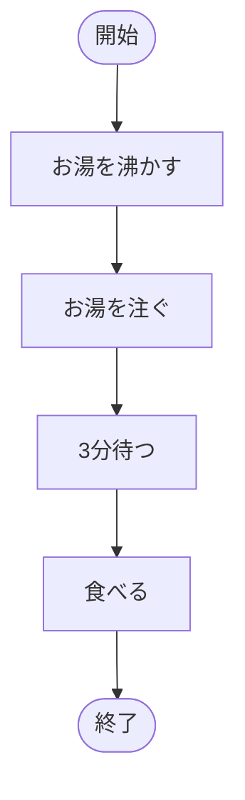
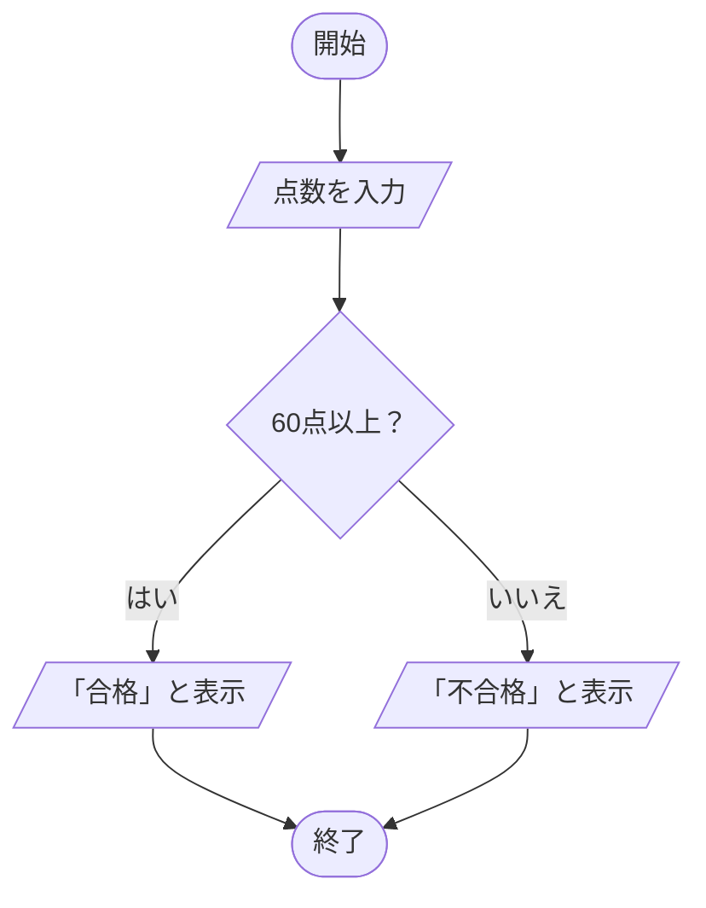
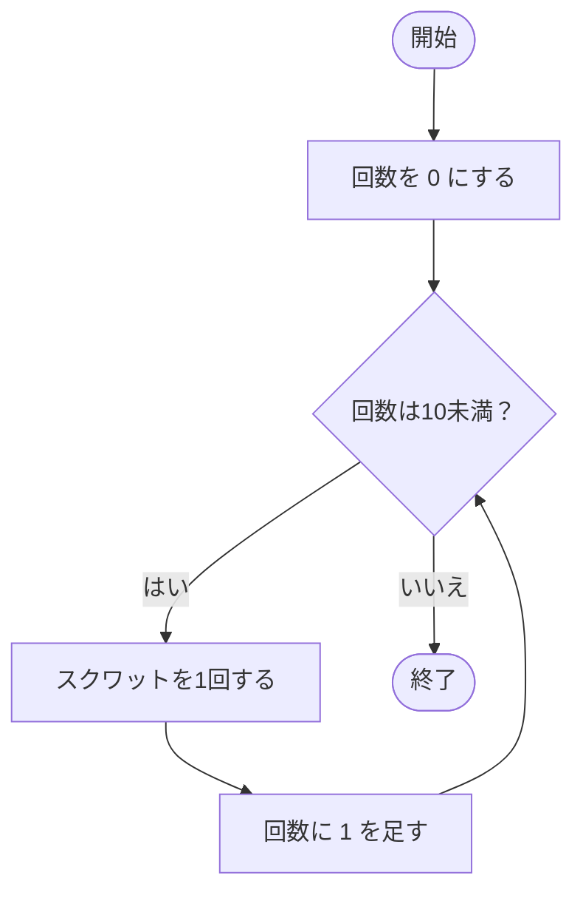
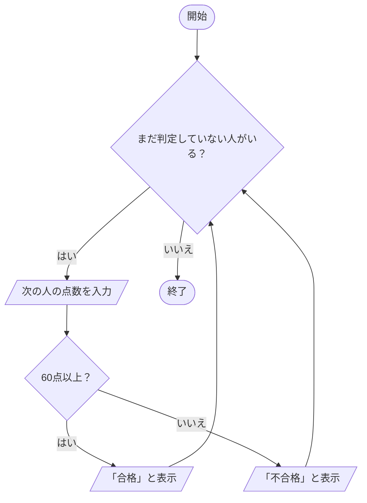
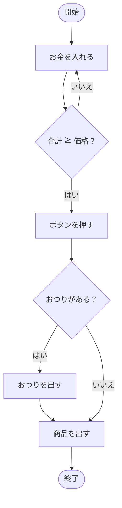

# 第3回 フローチャート集（プログラムの基本構造）

講義スライドのフローチャートを、ブラウザで見られる形にまとめたものです。
対応するPythonの例題は [examples/](examples/) にあります。

| 記号 | 名前 | 意味 |
| --- | --- | --- |
| 角の丸い長方形 | 端子 | 開始・終了 |
| 長方形 | 処理 | 何かを行う |
| 平行四辺形 | 入出力 | データを入れる・表示する |
| ひし形 | 判断 | 条件で道が分かれる（出る線に「はい／いいえ」を書く） |

## 1. 順次処理（[sequence.py](examples/sequence.py)）

書かれた順に、上から1つずつ実行する。

## 2. 分岐（[branch.py](examples/branch.py)）

条件によって、実行する処理を選ぶ。どちらの道を通っても、最後は1つに合流する。

## 3. 繰り返し（[loop.py](examples/loop.py)）

「何をくり返すか」と「いつ止めるか」をセットで考える。

## 4. 3つの構造の組み合わせ（[combined.py](examples/combined.py)）

繰り返しの中に分岐が入っている（入れ子）。

## 5. 例題：自動販売機でジュースを買う

| 手順書 | 構造 |
| --- | --- |
| 1. お金を入れる | 順次 |
| 2. 合計が足りなければ、1に戻る | 繰り返し |
| 3. 商品のボタンを押す | 順次 |
| 4. おつりがあれば、おつりを出す | 分岐 |
| 5. 商品を出す | 順次 |

手順書の「〜なら」「〜があれば」は分岐、「〜まで」「戻る」は繰り返しの合図です。
